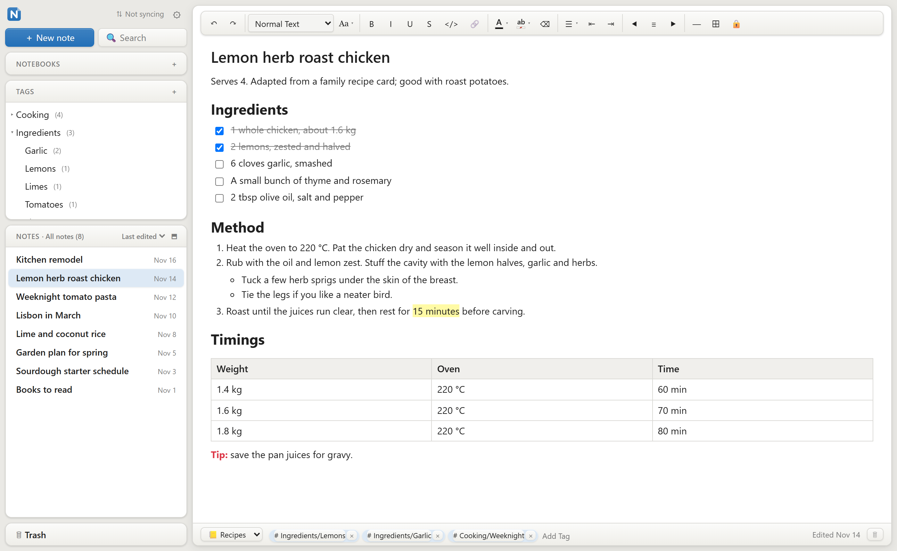
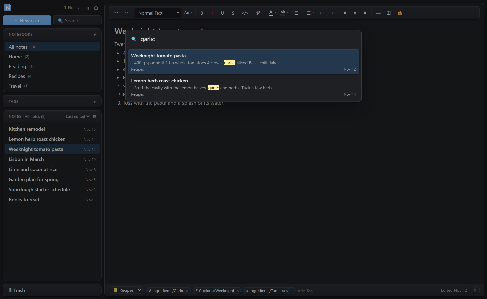
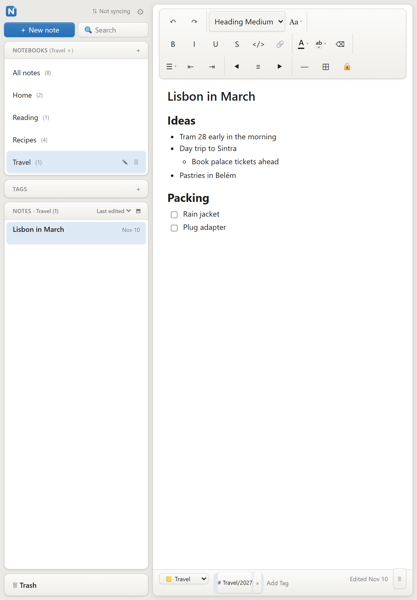

# note-it

A personal, self-hosted notes service built to replace Evernote for one user. Notes are real rich text (true indents, nested lists, tables, checklists, inline styles), not Markdown. Every device keeps a full local copy, works offline and syncs through a small server.

<table>
  <tr>
    <td width="62%"></td>
    <td width="38%"></td>
  </tr>
  <tr>
    <td>Search, in the dark theme</td>
    <td>Tablet, portrait</td>
  </tr>
</table>

Screenshots use made-up sample notes.

## Apps

| App | Status |
|---|---|
| **Desktop** (Windows, Tauri) | In daily use. |
| **Android tablet** (Capacitor) | Working: installed over USB, signs in with the tablet's own key and syncs. |
| **iPhone** (Capacitor) | Under development. It is expected to match the Android app feature for feature, insofar as Apple's guidelines allow. |
| **Sync server** (Node, Postgres) | Deployed at https://notes.tillmanjr.com. |

## Features

- **Rich-text editor** (TipTap) with headings, nested lists, checklists, tables, links, colors and highlights. Pasting from the web keeps the structure.
- **Notebooks** (a note is in one notebook) and **hierarchical tags** (`Ingredients/Lemons`). Filtering by a tag includes its sub-tags. Tags can be renamed by full path, dragged to a new parent and merged.
- **Search** over titles and bodies, offline on every device (SQLite FTS5).
- **Attachments and images**, stored by content hash.
- **Trash**, plus delete forever (which syncs to every device).
- **Vault sections:** select text and encrypt it in place with one passphrase. Only ciphertext leaves the device. A lost passphrase can't be recovered, by design.
- **Sync** that merges offline edits without losing any: note bodies are Yjs documents, and other fields use last-writer-wins per field.
- **Sign-in per device:** Windows Hello on the desktop, and a hardware-backed key on Android that asks for a fingerprint or the screen lock. Each new device is approved by an admin on the server.
- **Share to Notes** from other apps (Android).
- **Evernote import** of `.enex` exports (desktop).
- Light, dark and system themes.

## Repository layout

| Path | What it is |
|---|---|
| `apps/desktop` | The app's UI (React) and the Tauri desktop shell. The mobile apps use the same UI. |
| `apps/mobile` | The Capacitor project (Android; iOS to come) and its native plugins: device key and Share to Notes. |
| `apps/server` | Sync server: Fastify, Postgres, WebSocket notifications and the `notes-admin` CLI. |
| `packages/core` | Shared model, local store, sync client and ledger, vault crypto, passkey framing. |
| `packages/editor` | The TipTap editor and its extensions. |
| `packages/enex` | Evernote `.enex` import. |
| `deploy` | Droplet hardening, install and backup scripts. |
| `docs` | Design notes and runbooks (see below). |
| `spike/editor` | The first editor prototype (frozen). |

## Getting started (Windows)

1. Install Node 24 and [gitleaks](https://github.com/gitleaks/gitleaks) (`winget install Gitleaks.Gitleaks`). The pre-commit hook uses gitleaks to block committed secrets.
2. `npm install`
3. `npm run desktop` starts the desktop app. `npm run dev -w @tdjr/desktop` serves the same UI in a browser at http://localhost:5318.
4. `npm test` and `npm run typecheck` check the code. The server's end-to-end tests need Postgres (step 5) and are skipped without it.
5. To run a sync server locally: `npm run db:up -w @tdjr/server` (Postgres in Docker), then `npm run server`. Request access from the app's ⚙ menu, then approve with `npm run admin -w @tdjr/server -- pending` and `… -- approve <CODE>`.

In Windows PowerShell 5.1, use `npm.cmd` in place of `npm` if the execution policy blocks `npm.ps1`.

Android build and install: see [docs/mobile.md](docs/mobile.md).

### Ports

| Port | Use |
|---|---|
| 5318 | Desktop UI dev server (Vite) |
| 5319 | Sync server |
| 5320 | Postgres (Docker, local only) |

## Security

- Secrets are never committed. gitleaks runs before every commit and over the full history in CI.
- Server secrets are generated on the droplet, in root-owned files. Only public keys leave the PC.
- Devices sign in with keys that can't be exported or synced, and each device can be revoked on the server.
- Backups are encrypted with [age](https://age-encryption.org) before they leave the droplet.

## Documentation

- [design.md](docs/design.md): goals, architecture and milestones
- [STATUS.md](docs/STATUS.md): what's done and what's next
- [sync.md](docs/sync.md): how sync works
- [passkeys.md](docs/passkeys.md): device sign-in and approval
- [vault.md](docs/vault.md): encrypted sections
- [tags.md](docs/tags.md): tag paths, moving and merging
- [mobile.md](docs/mobile.md): the tablet app, building and installing
- [deploy.md](docs/deploy.md): the droplet, releases and backups
- [milestone-2.md](docs/milestone-2.md), [editor-spike.md](docs/editor-spike.md), [recommended-droplet.md](docs/recommended-droplet.md): earlier plans
